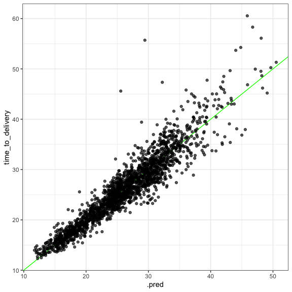

<!-- README.md is generated from README.Rmd. Please edit that file -->

```{r, include = FALSE}
knitr::opts_chunk$set(
  collapse = TRUE,
  comment = "#>",
  fig.path = "man/figures/README-",
  out.width = "100%"
)
```

# rbe 

<!-- badges: start -->
[](https://app.codecov.io/gh/tidymodels/rbe)
[](https://github.com/tidymodels/rbe/actions/workflows/R-CMD-check.yaml)
[](https://CRAN.R-project.org/package=rbe)
[](https://CRAN.R-project.org/package=rbe)
<!-- badges: end -->

rbe is an implementation of the RuleFit model of [Friedman and Popescu (2008)](https://doi.org/10.1214/07-AOAS148) that uses modern boosting methods such as XGBoost, LightGBM, and CatBoost.

The model has two parts:

- A boosted tree that generates a set of rules, which are logical statements that describe the variables used to get to the terminal nodes of the tree. 
- A regularized generalized linear model that takes the original predictors as well as a large set of binary indicators generated from the rule set.


## Installation

You can install the released version of rbe from [CRAN](https://CRAN.R-project.org) with:

``` r
install.packages("rbe")
```

You can install the development version of rbe from [GitHub](https://github.com/tidymodels/rbe) with:

``` r
pak::pak("tidymodels/rbe")
```

The xgboost and lightgbm packages are on CRAN. The catboost package is not on CRAN; see the [catboost installation instructions](https://catboost.ai/docs/en/installation/r-installation-binary-installation) to install it.

## Example

This example fits a RuleFit model to predict delivery times. The rules are made with xgboost:

```{r example}
library(rbe)
```

```{r}
#| label: yield-split

set.seed(273)
in_train <- 
  modeldata::deliveries |> 
  nrow() |> 
  sample.int(8000)

delivery_train <- modeldata::deliveries[in_train, ]
delivery_test <- modeldata::deliveries[-in_train, ]
```

```{r}
#| label: fit

set.seed(871)
rf_fit <- rule_ensemble(time_to_delivery ~ ., data = delivery_train, method = "xgboost")
rf_fit

rf_pred <- 
  predict(rf_fit, new_data = delivery_test) |> 
  dplyr::bind_cols(delivery_test)
```

```{r}
#| label: pred-plot
#| fig.width: 6
#| fig.height: 6
#| fig.show: hide
library(ggplot2)

rf_pred |> 
  ggplot(aes(.pred, time_to_delivery)) + 
  geom_abline(col = "green") + 
  geom_point(alpha = 2 / 3) +
  theme_bw()
```



## Code of Conduct
  
Please note that the rbe project is released with a [Contributor Code of Conduct](https://contributor-covenant.org/version/2/1/CODE_OF_CONDUCT.html). By contributing to this project, you agree to abide by its terms.


