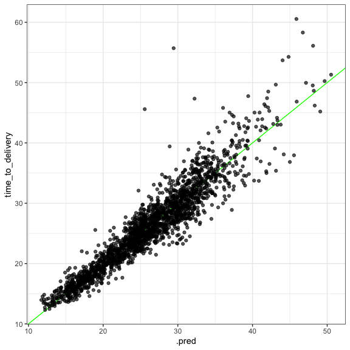

<!-- README.md is generated from README.Rmd. Please edit that file -->

# rbe

<!-- badges: start -->

[](https://app.codecov.io/gh/topepo/rbe)
[](https://github.com/topepo/rbe/actions/workflows/R-CMD-check.yaml)
<!-- badges: end -->

This package is another implementation of the RuleFit model of REFERENCE
that uses modern boosting methods such as XGBoost, LightGBM, and
CatBoost.

The model has two parts:

- A boosted tree that generates a set of rules, which are logical
  statements that describe the variables used to get to the terminal
  nodes of the tree.
- A regularized generalized linear model that takes the original
  predictors as well as a large set of binary indicators generated from
  the rule set.

## Installation

You can install the development version of rbe like so:

``` r
# FILL THIS IN! HOW CAN PEOPLE INSTALL YOUR DEV PACKAGE?
```

## Example

This is a basic example which shows you how to solve a common problem:

``` r
library(rbe)
```

``` r
set.seed(273)
in_train <- 
  modeldata::deliveries |> 
  nrow() |> 
  sample.int(8000)

delivery_train <- modeldata::deliveries[in_train, ]
delivery_test <- modeldata::deliveries[-in_train, ]
```

``` r
set.seed(871)
rf_fit <- rule_ensemble(time_to_delivery ~ ., data = delivery_train, method = "catboost")
rf_fit
#> RuleFit Using CatBoost
#> 
#> Training Set:
#> ℹ Samples: 8000
#> 
#> ℹ Predictors: 30
#> 
#> ℹ Rules: 381
#> 
#> 
#> Arguments:
#> • trees: 50
#> 
#> • mtry: 1
#> 
#> • learn_rate: 0.01
#> 
#> • tree_depth: 4
#> 
#> • penalty: 0.001
#> 
#> • mixture: 1

rf_pred <- 
  predict(rf_fit, new_data = delivery_test) |> 
  dplyr::bind_cols(delivery_test)
```

``` r
library(ggplot2)

rf_pred |> 
  ggplot(aes(.pred, time_to_delivery)) + 
  geom_abline(col = "green") + 
  geom_point(alpha = 2 / 3) +
  theme_bw()
```



## Code of Conduct

Please note that the parsnip project is released with a [Contributor
Code of
Conduct](https://contributor-covenant.org/version/2/1/CODE_OF_CONDUCT.html).
By contributing to this project, you agree to abide by its terms.
